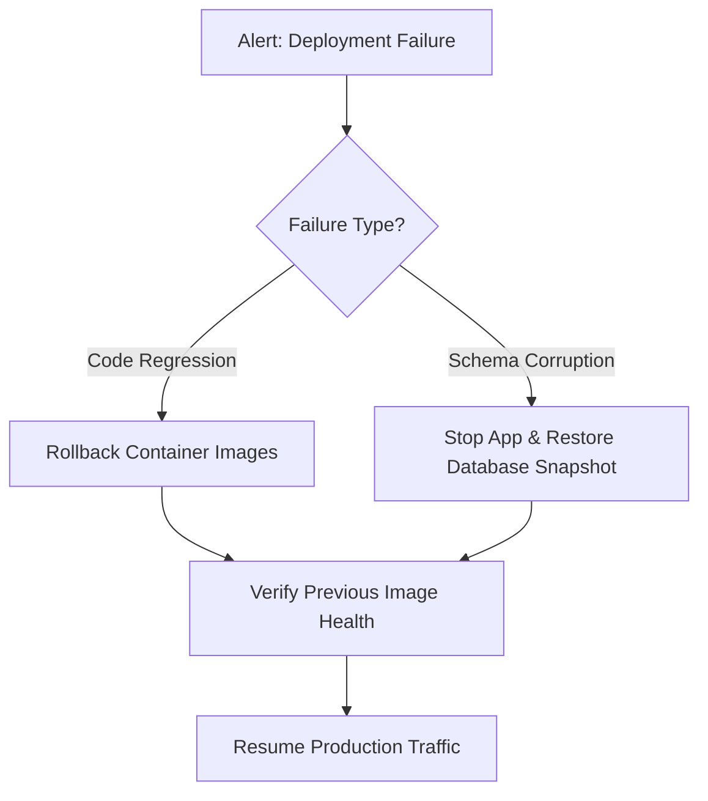

# KIBO360 Project Hub — Production Deployment Runbook

Complete operational execution runbook for launching, maintaining, rolling back, and troubleshooting the **KIBO360 Project Hub** in production for **Livexpert Technologies Pvt. Ltd.**

Target Domain: `https://kibo360.livexpert.in`  
Target Operating System: Linux (Ubuntu 22.04 LTS / RHEL 9) or Windows Server 2022

---

## 1. Pre-Deployment Checklist

Before initiating production deployment, confirm that each prerequisite is satisfied:

- [ ] **DNS Record Active**: `kibo360.livexpert.in` resolves via `A` or `CNAME` record to the production load balancer / host IP.
- [ ] **Firewall & Security Groups**:
  - Inbound Port `80` (HTTP for SSL redirect) open.
  - Inbound Port `443` (HTTPS for encrypted traffic) open.
  - Inbound Port `22` (SSH) restricted to VPN / administrative IP ranges.
  - Internal Ports `5000` (Node.js API) and `5432` (PostgreSQL) blocked from external internet access.
- [ ] **Docker & Docker Compose**: Engine 24.0+ and Compose v2.20+ installed and active.
- [ ] **Valid SSL/TLS Certificates**: Available at `deployment/ssl/kibo360.crt` and `deployment/ssl/kibo360.key`.
- [ ] **Environment Configuration**: `.env.production` configured and verified.

---

## 2. Pre-Flight Configuration Verification

Run the automated pre-flight environment validator:

```bash
# On Linux or Windows host:
npx tsx deployment/scripts/verify-env.ts .env.production
```

The script rigorously asserts:
1. `NODE_ENV` is strictly `production`.
2. `PORT` is a valid unprivileged port (e.g. `5000`).
3. `JWT_SECRET` has minimum 32 characters and high cryptographic entropy.
4. `DATABASE_URL` is a properly formed PostgreSQL connection string.
5. `CORS_ORIGIN` matches the exact production web origin (`https://kibo360.livexpert.in`).
6. `COMPANY_TIMEZONE` is an approved IANA timezone (e.g. `Asia/Kolkata`).
7. `ENABLE_HTTPS` is set to `true`.

> [!IMPORTANT]
> Do NOT proceed if `verify-env.ts` fails any checks. Correct `.env.production` before continuing.

---

## 3. Step-by-Step Production Launch Sequence

### Step 3.1: Provision Production Directories & Permissions
```bash
# On Linux host
sudo mkdir -p /var/kibo360/uploads /var/kibo360/backups /var/kibo360/logs
sudo chown -R 1000:1000 /var/kibo360/uploads
sudo chmod 750 /var/kibo360/uploads
```

### Step 3.2: Initialize Production PostgreSQL Database
If provisioning a new PostgreSQL instance:
```bash
# Initialize schema and unprivileged kibo360_app user
docker exec -i kibo360-postgres psql -U postgres < deployment/scripts/init-prod-db.sql
```

### Step 3.3: Deploy Database Migrations
Apply all schema changes:
```bash
npx prisma migrate deploy --schema=backend/prisma/schema.prisma
```
Verify migration status:
```bash
npx prisma migrate status --schema=backend/prisma/schema.prisma
```

### Step 3.4: Seed Production Roles, Departments & System Admin
```bash
npx tsx backend/src/seed.ts
```
*Note: Verify that system default departments (`dept-sw` for Software/IT and `dept-pd` for Product/Design) and the primary administrator (`admin@livexpert.in`) are seeded.*

### Step 3.5: Build & Launch Docker Production Stack
Launch the isolated container stack:
```bash
docker compose -f docker-compose.prod.yml up -d --build
```

Verify all three containers are healthy:
```bash
docker compose -f docker-compose.prod.yml ps
```
Expected output:
```
NAME               IMAGE                     COMMAND                  SERVICE    STATUS
kibo360-backend    kibo360-backend:latest    "docker-entrypoint.s…"   backend    Up (healthy)
kibo360-frontend   kibo360-frontend:latest   "/docker-entrypoint.…"   frontend   Up (healthy)
kibo360-postgres   postgres:16-alpine        "docker-entrypoint.s…"   postgres   Up (healthy)
```

---

## 4. Post-Deployment Verification & Smoke Tests

### 4.1 Automated Launch Checks Suite
Execute the 9-point production launch validation test:
```bash
npm --prefix backend test -- tests/launch_checks.test.ts
```

| Check # | Requirement | Verification Target |
| :---: | :--- | :--- |
| **1** | Authentication | Login with valid credentials dispatches JWT; logout revokes session. |
| **2** | Password Reset | Password reset request issues valid token; expired or tampered tokens rejected. |
| **3** | Role-Based Access Control | Level 4 (`ADMINISTRATOR`) permissions enforced; privilege escalation rejected. |
| **4** | Project & Task Persistence | Project and tasks persist across API calls with dynamic key uniqueness. |
| **5** | Deadlines & Notifications | Approaching/overdue deadline notifications trigger deduplicated inboxes. |
| **6** | KPI Reports Consistency | Reports calculate exact database figures (`onTimeRate`, `overdueCount`, `coverage`). |
| **7** | HTTPS & Security Headers | Strict HSTS, TLSv1.2/1.3, CSP, and X-Content-Type-Options active. |
| **8** | Secret Sanitization | Production error responses do not leak stack traces or secret keys. |
| **9** | Backup & Recovery | Automated backup snapshot created, verified, and restored with 100% data integrity. |

### 4.2 Endpoint Health Check
```bash
curl -k https://localhost/api/health
```
Ensure `"status": "UP"` and `"database": "CONNECTED"`.

---

## 5. Rollback Runbook

If a critical flaw, database migration failure, or fatal regression occurs during deployment:



### 5.1 Code-Only Rollback (No Schema Changes)
Revert to the previous container image tag:
```bash
# 1. Update image tags or check out previous Git release tag
git checkout tags/v1.0.0-stable

# 2. Re-deploy containers
docker compose -f docker-compose.prod.yml up -d --build
```

### 5.2 Full Disaster Recovery Rollback (Database + Code)
1. **Immediately halt traffic / stop application backend**:
   ```bash
   docker stop kibo360-backend
   ```
2. **Restore Database from Pre-Deployment Snapshot**:
   ```bash
   # Linux
   bash deployment/scripts/backup-cron.sh --restore /var/kibo360/backups/kibo360_prod_PRE_DEPLOY.sql.gz
   
   # Or directly with psql:
   gunzip -c /var/kibo360/backups/kibo360_prod_PRE_DEPLOY.sql.gz | docker exec -i kibo360-postgres psql -U postgres -d kibo360_prod
   ```
3. **Rollback Application Code**:
   ```bash
   git checkout tags/v1.0.0-stable
   docker compose -f docker-compose.prod.yml up -d --build backend
   ```
4. **Run Smoke Test Suite**:
   ```bash
   npm --prefix backend test -- tests/launch_checks.test.ts
   ```

---

## 6. Emergency Troubleshooting

### 6.1 Backend Process In Crash Loop
- **Symptom**: `docker ps` shows backend container restarting repeatedly (`Restarting (1)`).
- **Diagnostics**:
  ```bash
  docker logs kibo360-backend --tail 100
  ```
- **Common Causes**:
  - Missing or invalid environment variable (e.g., `JWT_SECRET` too short).
  - Unable to resolve or connect to PostgreSQL host `postgres:5432`.
  - Database migrations have not been applied (`PrismaClientKnownRequestError: Table does not exist`).

### 6.2 SSL Handshake Failures / HTTPS Errors
- **Symptom**: Browser reports `NET::ERR_CERT_COMMON_NAME_INVALID` or `SSL_ERROR_BAD_CERT_DOMAIN`.
- **Resolution**:
  1. Inspect certificate Common Name (CN) and Subject Alternative Names (SAN):
     ```bash
     openssl x509 -in deployment/ssl/kibo360.crt -text -noout | grep -A 2 "Subject Alternative Name"
     ```
  2. Verify that Nginx SSL configuration specifies correct certificate paths:
     ```nginx
     ssl_certificate /etc/nginx/ssl/kibo360.crt;
     ssl_certificate_key /etc/nginx/ssl/kibo360.key;
     ```

### 6.3 Memory Leak / Process Bloat
- **Symptom**: Host memory exhaustion or backend restart due to OOM (`Exit Code 137`).
- **Mitigation**:
  - The backend Dockerfile and PM2 ecosystem enforce `max_memory_restart: 500M`.
  - If a specific heavy report or query consumes excessive memory:
    ```bash
    # Inspect heap dump metrics via health endpoint
    curl https://kibo360.livexpert.in/api/health | jq '.memory'
    ```

---

*Livexpert Technologies Pvt. Ltd. — Production Operations & Reliability Engineering.*
